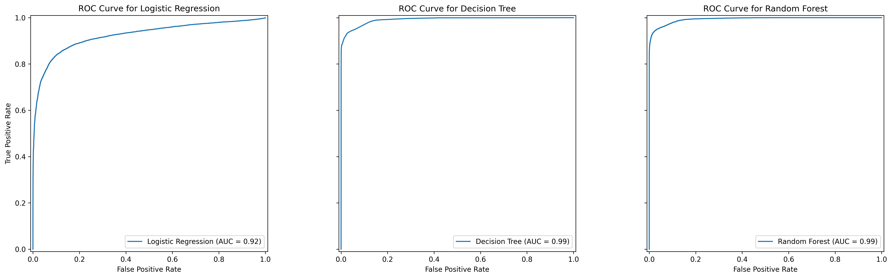
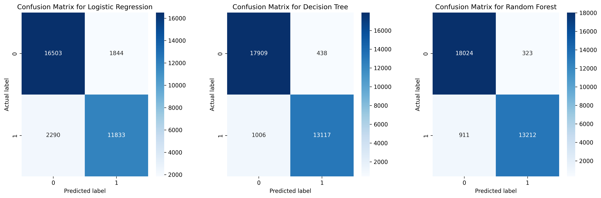
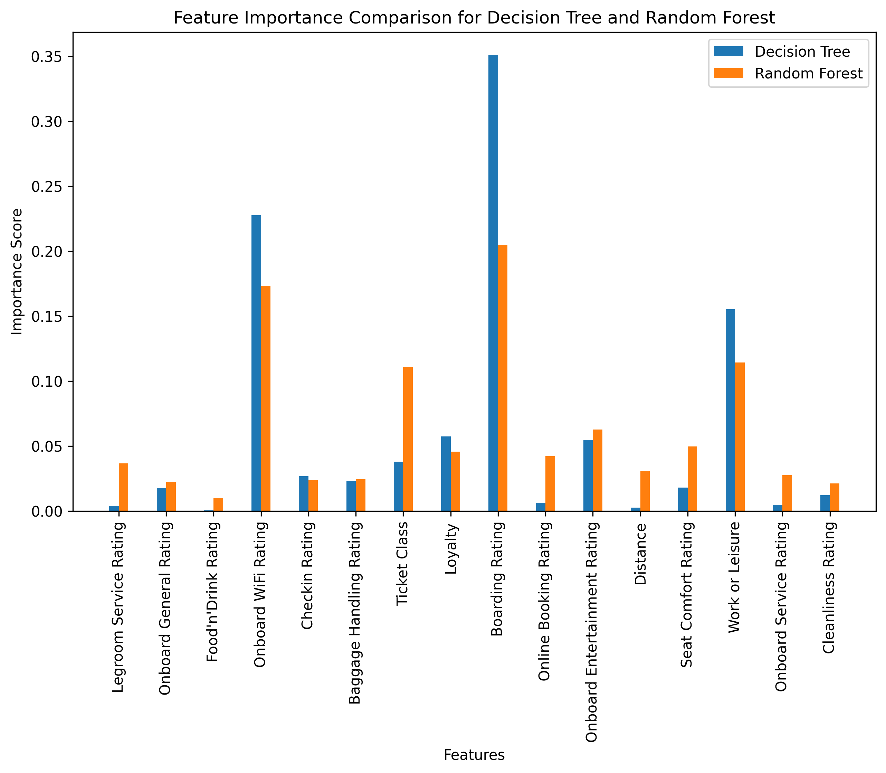

# Customer Satisfaction ML: Train Passengers

> Predicts whether a train passenger is satisfied from their service ratings and trip details, comparing logistic regression, a decision tree and a random forest.

 

## TL;DR
- **Problem:** a train company wants to know which passengers are satisfied without asking them directly, to target promotions and improve retention. Binary classification on 129,880 passengers.
- **Approach:** EDA, train/test split first, then imputation, correlation-based feature selection and outlier removal fitted on the training set only; three models tuned with randomized search followed by grid search.
- **Result:** the random forest reaches **0.962 accuracy** and **0.994 ROC AUC** on 32,470 held-out passengers, against 0.565 for a majority-class baseline.
- **Stack:** Python, pandas, NumPy, scikit-learn, matplotlib, seaborn, Jupyter.



## Data
`trains.csv`: 129,880 passengers x 25 columns, provided by the Artificial Intelligence and Machine Learning course at LUISS Guido Carli (2023-2024). It is **not redistributed** in this repository; to run the notebook, place the file at `data/raw/trains.csv`.

- **Target:** `Satisfied` (Y/N), 43.4% satisfied.
- **Features:** 14 service ratings on a 0-5 scale (boarding, WiFi, seat comfort, cleanliness...), age, distance, departure and arrival delay, ticket class (Economy, Smart, Premium), loyalty, gender, travel purpose (work or leisure), plus a ticket ID and a timestamp that are dropped.
- **Missing values:** 393 in `Arrival Delay in Minutes` only.

## Approach
Everything is in [`notebooks/customer_satisfaction.ipynb`](notebooks/customer_satisfaction.ipynb), which is stored with its outputs.

1. **EDA** on the full dataset (distributions, boxplots, correlation matrix). It is exploratory only: nothing computed here is used by the models.
2. **Split first:** 75% train (97,410 rows), 25% test (32,470 rows), `random_state=42`. Every step below that learns from data is fitted on the training set and applied to the test set.
3. **Preprocessing:**
   - mode imputation (train modes);
   - encoding: binary maps for loyalty, gender, travel purpose and the target; ordinal encoding for ticket class;
   - feature selection: features with an absolute correlation with the target below 0.15 on the training set are dropped (age, gender, both delays, departure/arrival time rating, track location rating), leaving 16 features;
   - outliers: IQR bounds on `Distance` computed on the training set; 2,115 training rows are removed, the test set keeps all its rows;
   - standardisation (`StandardScaler` fitted on the training set).
4. **Models:** majority-class baseline, logistic regression, decision tree, random forest. Default models are first compared on a validation split of the training set (validation accuracy: baseline 0.572, LR 0.871, DT 0.941, RF 0.960).
5. **Tuning:** `RandomizedSearchCV` over a wide space, then `GridSearchCV` in a narrow neighbourhood of the best random-search parameters.
6. **Evaluation** on the test set, used once: classification report, confusion matrices, ROC curves, learning curves and feature importance.

## Results
Test set (32,470 passengers, never used for fitting or tuning). Precision, recall and F1 are weighted averages over the two classes, as in the notebook.

| Model | Accuracy | Precision | Recall | F1 | ROC AUC |
|---|---|---|---|---|---|
| Majority class (always "not satisfied") | 0.565 | - | - | - | - |
| Logistic regression | 0.873 | 0.872 | 0.873 | 0.872 | 0.924 |
| Decision tree | 0.956 | 0.956 | 0.956 | 0.955 | 0.992 |
| **Random forest** | **0.962** | **0.962** | **0.962** | **0.962** | **0.994** |



- The two tree models are far ahead of logistic regression, which suggests non-linear effects and interactions between ratings.
- The random forest is only slightly better than the tuned decision tree (911 vs 1,006 false negatives, 323 vs 438 false positives) at a much higher training cost.
- Learning curves: the tuned decision tree has a small train/CV gap (about 0.003); the random forest has a larger one (about 0.99 vs 0.96) and its CV score is still rising, so it would likely benefit from more data.

**What drives satisfaction.** Boarding rating, onboard WiFi rating and travel purpose are the three most important features for both tree models; for logistic regression (absolute coefficients on standardised features) the top three are travel purpose, boarding rating and loyalty. The travel-purpose effect is large in the raw data: 58% of work travellers are satisfied against 10% of leisure travellers.



More figures (histograms, boxplots, correlation matrix, learning curves, LR coefficients) are in [`Images/`](Images/) and in the notebook.

## What changed from the course version
The original 2023-2024 submission fitted imputation, feature selection and outlier bounds on the full dataset before the train/test split, so the test set influenced preprocessing. In 2026 the notebook was restructured to split first and fit every step on the training set only, and a few other issues were fixed: ROC curves now use the tuned models instead of the default ones, the learning curves use all the tuned parameters, `random_state` is fixed everywhere, and a majority-class baseline was added. The headline test accuracies did not change at two decimals (0.87 / 0.96 / 0.96), but the test set is now a true hold-out (32,470 rows instead of 31,754 after outlier removal).

## How to run
Tested with Python 3.13.2 on Windows.

```bash
git clone https://github.com/Mturco3/customer-satisfaction-ml.git
cd customer-satisfaction-ml
python -m venv .venv
.venv\Scripts\activate            # macOS/Linux: source .venv/bin/activate
pip install -r requirements.txt
mkdir data\raw                    # macOS/Linux: mkdir -p data/raw; then copy trains.csv into it
cd notebooks
jupyter notebook customer_satisfaction.ipynb
```

Run the notebook from the `notebooks/` folder with the virtual environment activated (the kernel uses the `python` on your PATH). A full run takes about 15 minutes, mostly the random forest searches, and rewrites the 15 figures in `Images/`. To run it headless instead:

```bash
jupyter nbconvert --to notebook --execute customer_satisfaction.ipynb --output customer_satisfaction_run.ipynb
```

## Project structure
```
customer-satisfaction-ml/
├── notebooks/
│   └── customer_satisfaction.ipynb   # full analysis, stored with outputs
├── Images/                           # 15 figures written by the notebook
├── data/raw/trains.csv               # not in the repo (see Data)
├── requirements.txt                  # pinned versions used for the results
└── README.md
```

## Limitations and next steps
- **Scaling before cross-validation:** the scaler is fitted on the whole training set before the searches, so each CV fold sees statistics from its validation part. The effect is small and only matters for logistic regression (trees are scale-invariant); a `Pipeline(scaler, model)` inside the searches would remove it.
- **Small tuning budget:** 10 random-search iterations for LR and DT, 5 for the random forest (3-fold CV), and the random forest grid search uses only 2 folds. The grid searches explore a narrow neighbourhood, so the parameters are a local optimum.
- **Feature selection** uses univariate Pearson correlation with a fixed 0.15 threshold. It ignores non-linear and interaction effects, and the threshold was not tuned.
- **Single split:** one 75/25 split, not stratified (the satisfied share is 42.7% in train and 43.5% in test), and no confidence intervals on the test metrics.
- **Feature importance** is impurity-based for the trees (biased towards features with many values) and coefficient-based for LR; both describe associations, not causes.
- **Class imbalance** (57% / 43%) is moderate and not corrected.
- **Reproducibility** depends on the course dataset, which is not public here. Results come from the pinned `requirements.txt`; a run on the latest packages (October 2026) gave the same numbers, with deprecation warnings (`penalty=` in `LogisticRegression` is removed in scikit-learn 1.10).
- **Next steps:** pipelines inside the CV, a stratified split, a gradient boosting model, permutation importance, and choosing a decision threshold based on the cost of false positives vs false negatives.

## Authors
Group project for the Artificial Intelligence and Machine Learning course, LUISS Guido Carli, 2023-2024:
- Simone Filosofi
- Simone Angelo Meli
- Michele Turco

The 2026 revision (leakage fixes, reproducibility, this README) is by Michele Turco.

## License
No license has been chosen yet.
